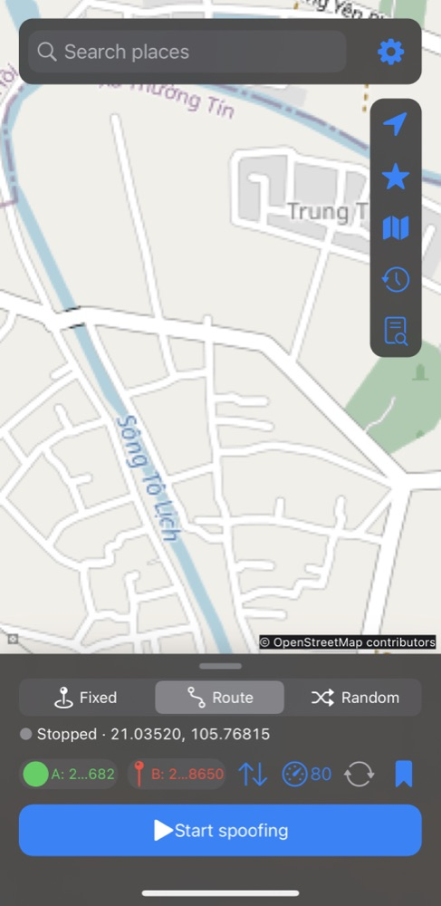

# GPSNav

GPSNav is a location simulator for jailbroken iOS 16.0 and later on arm64/arm64e. It supports rootless and rootful jailbreaks. Author: Tieu Me.

## Preview

<p align="center"></p>

## Features and use

- **Map**: built-in OpenStreetMap map with pan, pinch and double-tap zoom. The location button centers on your real position with an accuracy circle.
- **Fixed**: long-press the map (or pick a search result / bookmark) to choose a point, then tap **Start spoofing**.
- **Route**: set A and B, then the app routes along real roads (MapKit directions with OSRM fallback). Choose the speed in km/h, toggle reverse loop (A→B→A…), and save the route.
- **Random**: jumps to a random point within a radius around the selected point at a set interval.
- **Search** with history (Nominatim fallback), **Bookmarks**, **Saved routes** and **History** from the right-hand buttons.
- **Logs**: built-in log viewer (App / Engine / Tweak) with diagnostics, copy and share.
- **Settings**: bundle ID blacklist (apps that keep the real location) and About.
- SpringBoard runs the simulation in the background and restores its progress after a respring.

## Install

Add the Sileo source `https://xtieume.github.io/gps-navigation/` and install **GPSNav**, or install the deb manually:

Choose the rootless `iphoneos-arm64` or rootful `iphoneos-arm` deb for your jailbreak. Transfer it to the device and install with Sileo or Filza. Respring to load the tweak into SpringBoard and restart target apps. Enable tweak injection in the jailbreak if required. Remove the package with your package manager.

## Limitations

- Requires a compatible jailbreak and tweak loader; this is not an App Store app. No device runtime verification is included in the build.
- Only Core Location manager APIs in injected app processes are substituted; other sources, system daemons, server-side checks, heading, and apps that block injection are unaffected. Apps may detect simulated or inconsistent location data.
- The blacklist is read once per app launch. A sandbox may prevent reading the shared plist, in which case that app is not excluded; restart affected apps after editing it.
- MapKit search and directions need network access and availability varies by region. Random mode jumps rather than traveling between points. Route movement is tick-based and may cut across very short polyline segments.
- The app writes an unsandboxed preferences file; enabling the required private entitlements depends on the jailbreak. Current position/progress is stored separately in the same preferences directory to avoid overwriting settings.

## Build

Install Xcode with an iPhoneOS SDK, Theos at `~/theos`, and `ldid`, GNU make, and `dpkg` (e.g. `brew install ldid make dpkg`). From a checkout whose path contains no spaces:

```sh
export THEOS="$HOME/theos"
export PATH="$(brew --prefix make)/libexec/gnubin:$PATH"
make package FINALPACKAGE=1 THEOS_PACKAGE_SCHEME=rootless
make clean
make package FINALPACKAGE=1
```

Packages appear in `packages/`. Theos does not support spaces in project paths; copy the checkout to a path without spaces before building if needed. The portable geography test can be run with `cc tests/geo_test.c Shared/Geo.c -lm -o /tmp/gpsnav-geo-test && /tmp/gpsnav-geo-test`.

MIT licensed; see [LICENSE](LICENSE).
