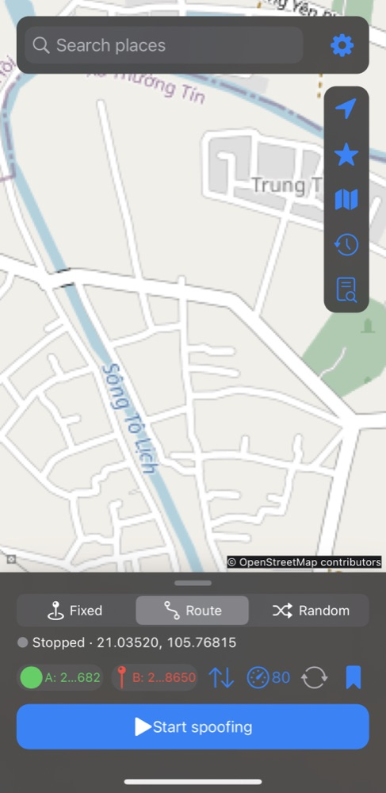

# GPSNav

GPSNav mô phỏng vị trí cho iOS 16.0 trở lên đã jailbreak, hỗ trợ arm64/arm64e, rootless và rootful. Tác giả: Tieu Me.

## Xem trước

<p align="center"></p>

## Tính năng và cách dùng

- **Bản đồ**: bản đồ OpenStreetMap tích hợp, kéo, chụm và chạm đúp để zoom. Nút định vị đưa về vị trí thật kèm vòng tròn độ chính xác.
- **Fixed**: nhấn giữ bản đồ (hoặc chọn kết quả tìm kiếm / bookmark) để chọn điểm, rồi bấm **Start spoofing**.
- **Route**: đặt A và B, ứng dụng tìm đường theo đường thật (MapKit, dự phòng OSRM). Chọn tốc độ km/h, bật dao động tốc độ ngẫu nhiên (±10–100%), lặp đảo chiều (A→B→A…) và lưu tuyến.
- **Random**: nhảy tới điểm ngẫu nhiên trong bán kính quanh điểm đã chọn theo chu kỳ.
- **Tìm kiếm** có lịch sử (dự phòng Nominatim), **Bookmarks**, **Tuyến đã lưu** và **Lịch sử** ở cột nút bên phải.
- **Logs**: xem log tích hợp (App / Engine / Tweak), chạy chẩn đoán, sao chép và chia sẻ.
- **Settings**: danh sách bundle ID không giả lập (giữ vị trí thật) và thông tin ứng dụng.
- SpringBoard tiếp tục mô phỏng khi ứng dụng ở nền và khôi phục tiến độ sau respring.

## Cài đặt

Thêm nguồn Sileo `https://xtieume.github.io/gps-navigation/` rồi cài **GPSNav**, hoặc cài deb thủ công:

Chọn gói rootless `iphoneos-arm64` hoặc rootful `iphoneos-arm` phù hợp với jailbreak. Chuyển tệp deb vào thiết bị và cài bằng Sileo hoặc Filza. Respring để nạp tweak vào SpringBoard rồi khởi động lại các ứng dụng cần dùng. Bật tính năng nạp tweak của jailbreak nếu cần. Gỡ bằng trình quản lý gói.

## Giới hạn

- Cần jailbreak và bộ nạp tweak tương thích; đây không phải ứng dụng App Store. Chưa kiểm thử hoạt động trên thiết bị trong quá trình build.
- Chỉ thay thế vị trí qua Core Location manager trong các ứng dụng được nạp tweak; nguồn vị trí khác, daemon, kiểm tra phía máy chủ, hướng la bàn và ứng dụng chặn nạp tweak không bị ảnh hưởng. Ứng dụng có thể phát hiện vị trí giả hoặc dữ liệu không nhất quán.
- Danh sách loại trừ được đọc một lần khi ứng dụng khởi chạy. Sandbox có thể chặn đọc plist, khi đó ứng dụng không được loại trừ; hãy khởi động lại ứng dụng sau khi chỉnh sửa.
- Tìm kiếm và chỉ đường MapKit cần mạng và tùy khu vực. Chế độ ngẫu nhiên nhảy giữa các điểm. Tuyến cập nhật theo giây và có thể đi tắt qua các đoạn rất ngắn.
- Ứng dụng cần quyền riêng của jailbreak để ghi tệp cấu hình ngoài sandbox. Vị trí và tiến độ được lưu riêng trong cùng thư mục preferences để tránh ghi đè cấu hình.

## Build

Cài Xcode với iPhoneOS SDK, Theos tại `~/theos`, cùng `ldid`, GNU make và `dpkg` (`brew install ldid make dpkg`). Chạy trong thư mục không có khoảng trắng:

```sh
export THEOS="$HOME/theos"
export PATH="$(brew --prefix make)/libexec/gnubin:$PATH"
make package FINALPACKAGE=1 THEOS_PACKAGE_SCHEME=rootless
make clean
make package FINALPACKAGE=1
```

Các gói nằm trong `packages/`. Theos không hỗ trợ khoảng trắng trong đường dẫn dự án; nếu cần, sao chép dự án đến đường dẫn không có khoảng trắng trước khi build. Kiểm thử tính toán tọa độ bằng `cc tests/geo_test.c Shared/Geo.c -lm -o /tmp/gpsnav-geo-test && /tmp/gpsnav-geo-test`.

Giấy phép MIT: [LICENSE](LICENSE).
